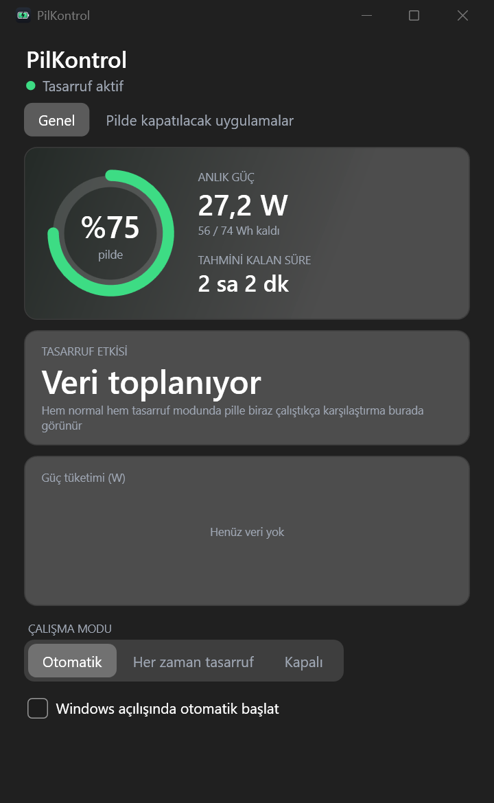

# PilKontrol

Windows laptoplar, özellikle oyuncu bilgisayarları için pil ömrünü uzatan, arka planda çalışan bir araç.
Prizden çekince kendiliğinden tasarruf moduna geçer, prize takınca her şeyi eski haline getirir.
Tepsi ikonu ve canlı bir panel ile anlık watt, tahmini kalan süre ve tasarruf etkisini gösterir.

<p align="center"></p>

## Kurulum

[Releases](../../releases) sayfasından `PilKontrol-Setup-x.y.z.exe` dosyasını indirip çalıştır.
.NET kurmana gerek yok, her şey paketin içinde. Yönetici izni de istemez (kullanıcı bazlı kurulur).

Kurulum sihirbazı isteğe bağlı olarak Windows açılışında tepsiye sessizce yerleşmeyi ayarlar.
Kaldırınca eski güç planın geri gelir, PilKontrol'ün oluşturduğu planlar silinir.

## Ne yapar?

Sadece **pildeyken** devreye girer, prizdeki performansa dokunmaz. **Parlaklığa hiç dokunmaz.**

| İş | Detay |
|---|---|
| Güç planı | Turbo boost kapalı, işlemci verimlilik eğilimli, PCIe/Wi-Fi/USB güç tasarrufu, disk/ekran/uyku süreleri kısalır |
| Ekran yenileme hızı | 60 Hz'in üstündeyse 60 Hz'e iner, prizde geri döner |
| **Kıs** (uygulama bazında) | Uygulama açık kalır; düşük öncelik + EcoQoS (Görev Yöneticisi "Verimlilik modu") + toplam CPU'nun %3'üne sert sınır (Job nesnesi). Prizde serbest kalır |
| **Kapat** (uygulama bazında) | Pile geçince kapatılır, prize takınca yeniden açılır |
| Pil ≤ %20 | "Ultra" plan: işlemci %60 ile sınırlı |

Hangi uygulamaların kısılacağını ya da kapatılacağını panelde **Pilde kapatılacak uygulamalar** sekmesinden seçersin.
Liste, o an CPU kullanan uygulamaları gösterir. Çıkışta (tepsi ikonu > Çıkış) her şey eski haline döner.

### Modlar

- **Otomatik**: pilde tasarruf, prizde normal.
- **Her zaman tasarruf**: prizde de tasarruf planı açık kalır.
- **Kapalı**: hiçbir şey yapmaz.

### Tasarruf etkisi nasıl ölçülür?

Pilin anlık deşarj gücü (watt) WMI'dan 30 saniyede bir okunur. Normal ve tasarruf modundaki ortalamalar
karşılaştırılır. İki modda da pille biraz çalıştıktan sonra panelde fark görünür. İki ölçüm farklı işler
yaparken alındıysa bu karşılaştırma kaba bir tahmindir.

## Oyuncu laptopu ipuçları

- **Ekran kartı:** Boşta bile RTX kartı uyanık tutan uygulamalar pili yer. Windows Ayarlar > Ekran > Grafikler'den
  uygulamayı "Güç tasarrufu" yap, ya da üretici yazılımında (Armoury Crate, MyASUS, Omen vb.) iGPU/Eco modunu aç.
- Medal, DynamicWin gibi sürekli çalışan uygulamalar çok CPU yer. Panelden **Kıs** ya da **Kapat** olarak işaretle.

## Kaynaktan derleme

Gerekenler: Windows 10/11 ve [.NET 10 SDK](https://dotnet.microsoft.com/download).

```
cd PilKontrol
dotnet run -c Release
```

Tek dosyalık `.exe` ve kurulum sihirbazı (için [Inno Setup 6](https://jrsoftware.org/isinfo.php) gerekir):

```
dotnet publish PilKontrol -c Release -r win-x64 --self-contained -p:PublishSingleFile=true -p:IncludeNativeLibrariesForSelfExtract=true -p:EnableCompressionInSingleFile=true -p:DebugType=none -o publish
iscc installer\PilKontrol.iss
```

Çıktı `dist\PilKontrol-Setup-<sürüm>.exe` olur. Etiket (`v1.0.0` gibi) gönderince
`.github/workflows/release.yml` bunu otomatik yapıp Releases'e yükler.

## Teknik notlar

- C# / .NET 10, WPF (Fluent koyu tema) + Windows Forms tepsi ikonu.
- Ayarlar `%APPDATA%\PilKontrol\settings.json` içinde; `PILKONTROL_DATA` ortam değişkeniyle klasör değiştirilebilir.
- Komut satırı: `--tray` (sadece tepsi), `--quit` (çalışan kopyayı düzgünce kapat), `--cleanup` (kaldırma temizliği).
- `legacy-python/` içinde ilk Python prototipi durur, artık geliştirilmiyor.

## Lisans

[MIT](LICENSE)
